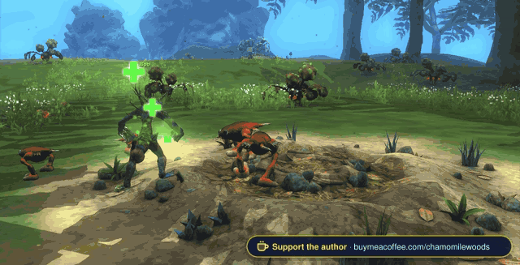
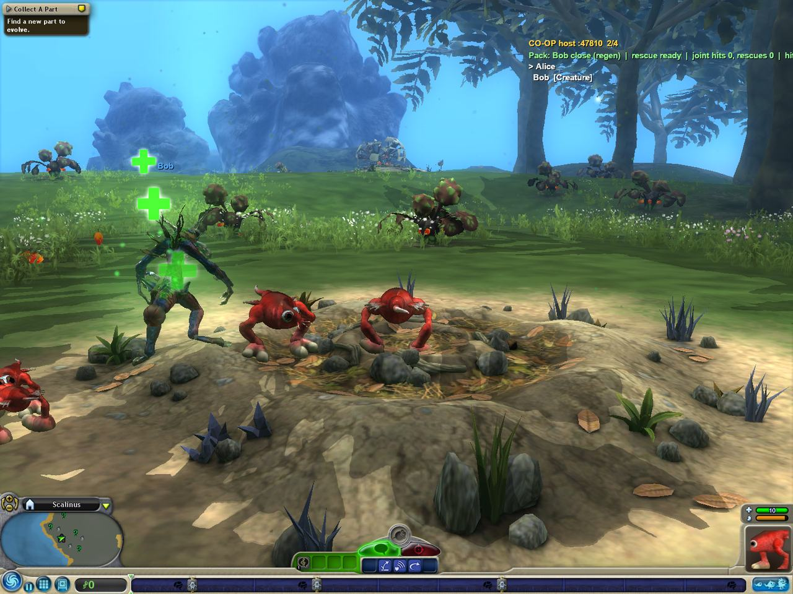
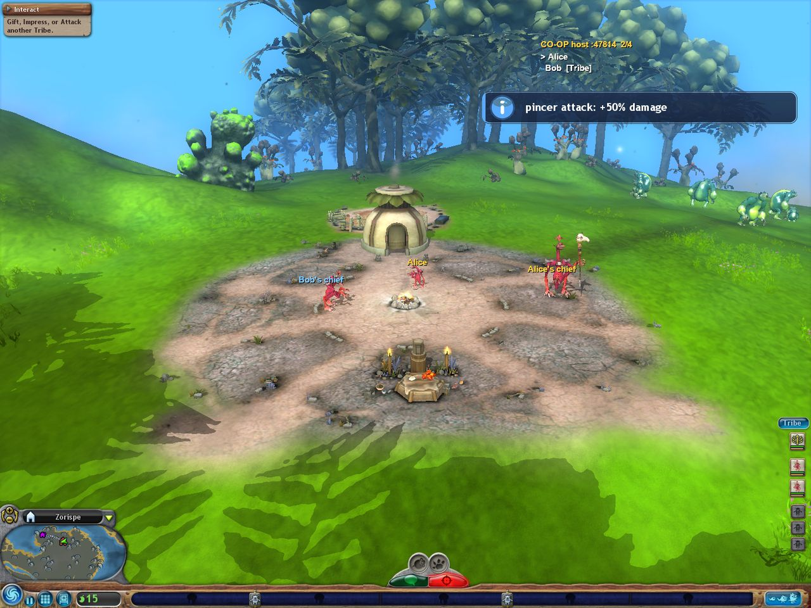
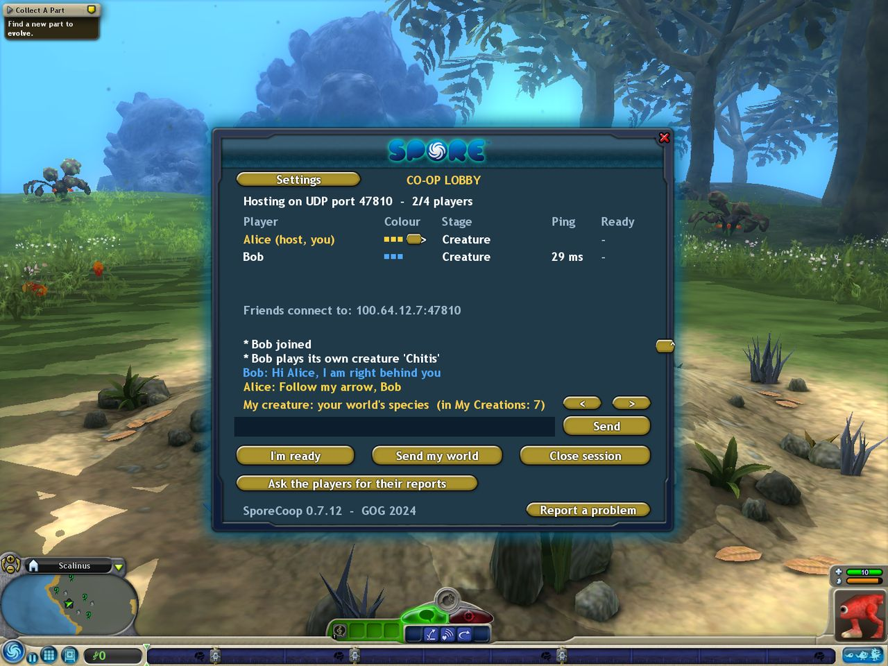
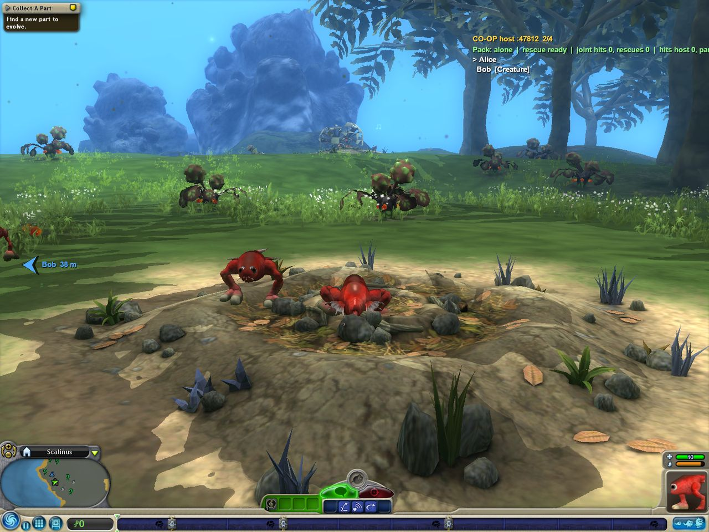
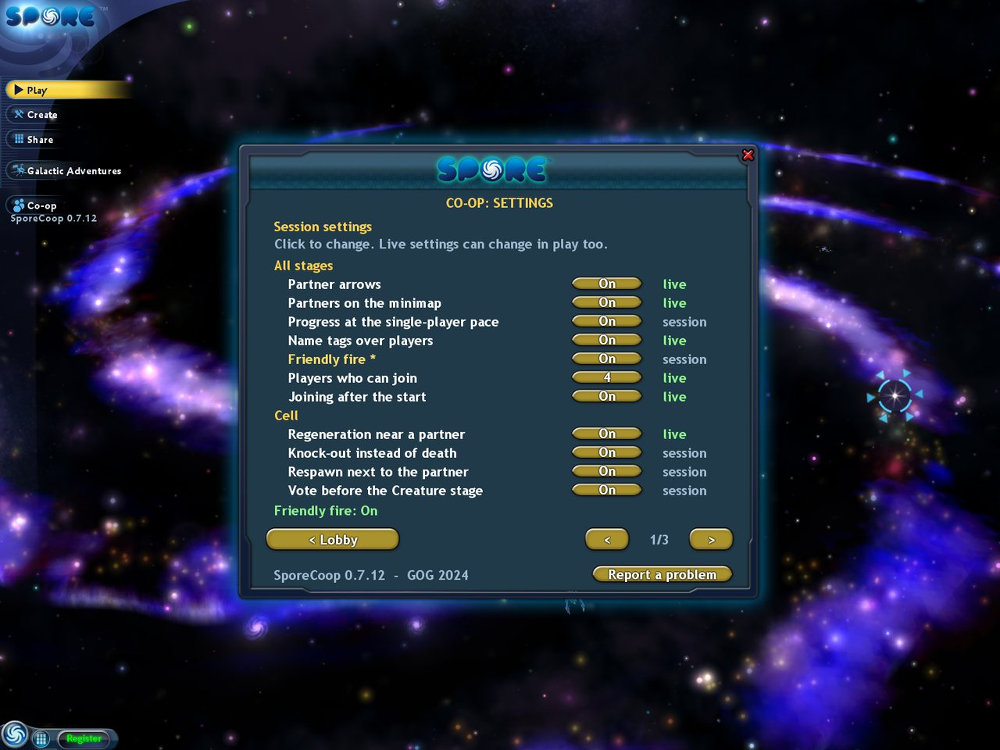
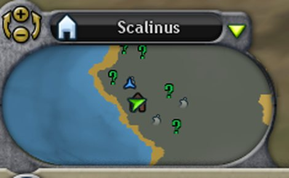

<p align="center">
  
</p>

<p align="center">
  <b>Two to four players, one shared world: evolve together as a team or race head-to-head as rivals, from the tide pool to the galactic core.</b>
</p>

<p align="center">
  <!-- support:top:start -->
  <a href="https://buymeacoffee.com/chamomilewoods"></a>
  <!-- support:top:end -->
  &nbsp;
  <a href="https://github.com/WoodyWizard/SporeCoop/releases/latest"></a>
  &nbsp;
  <a href="https://discord.gg/7Yre7u4b8x"></a>
</p>

<p align="center">
  <a href="https://github.com/WoodyWizard/SporeCoop/actions/workflows/build.yml"></a>
  <a href="LICENSE"></a>
  
  
  
  
</p>

<p align="center">
  <a href="#quick-start">Quick start</a> ·
  <a href="#whats-new-in-08">What's new</a> ·
  <a href="#two-ways-to-play-together-vs-rivals">Together vs Rivals</a> ·
  <a href="#every-stage-together-and-as-rivals">Every stage</a> ·
  <a href="#features-and-quality-of-life">Features</a> ·
  <a href="#session-settings">Settings</a> ·
  <a href="#install">Install</a> ·
  <a href="#how-to-play">How to play</a> ·
  <a href="#faq">FAQ</a>
</p>

<p align="center">
  
  <br><sub>Two players in the Creature stage: Alice (the host) and Bob playing his own creature from <i>My Creations</i> in one shared world.</sub>
</p>

---

## Quick start

1. **Download** `SporeCoopSetup.exe` from [Releases](https://github.com/WoodyWizard/SporeCoop/releases/latest) and run it
   (on Linux: inside the game's Wine prefix, e.g. Bottles *Run Executable...*).
2. **Install:** the setup automatically finds Spore + Galactic Adventures (GOG or Steam), lets you choose the newest
   release (or roll back to a previous one), downloads it from GitHub, and verifies every file. Every player installs
   the same version.
3. **Play:** launch Spore, open **Co-op** from the galaxy menu, and enter your name.
   - **Host:** pick **Host a game**, optionally set a password, choose **All together**, **All rivals**, or a custom
     per-stage mix, and load or start a planet.
   - **Guest:** pick **Join a game**, click the host under *Games on your network* (or pick from *Recent servers* / type
     the host's address), and the host's world loads automatically.
   - **Over the internet:** use a virtual LAN such as Tailscale, or forward UDP port `47810` ([how](docs/INSTALL.md#7-playing-over-the-internet)).

> [!TIP]
> Need step-by-step screenshots, Linux instructions, or help with Steam's `Spore 24720` folder?
> See **[docs/INSTALL.md](docs/INSTALL.md)**.

---

## What's new in 0.8

**SporeCoop 0.8 (`v0.8.2.3`)** is the biggest leap since launch: full **Rivals mode** across all five stages,
**co-op Galactic Adventures** with a **Shared Adventure Editor**, independent per-player evolution paths, and major
lobby, camera, and editor upgrades.

- **⚔️ Rivals mode across all 5 stages:** every player gets their own nest and herd, tribe village, civilization
  nation, and emigrated Space homeworld in the same world. Race to win each stage, wage war with inviolable home bases,
  form alliances, spend **Influence** on NPC factions (*Turn*, *Protect*, *Smooth*), pick winner-draft rewards, and
  compete for the **Chronicle** trophy.
- **🧬 Independent evolution & mid-game starting path picker (`0.8.1`):** every player earns their own DNA, Tribe and
  Civilization consequence cards, outfits, buildings, vehicles, Tribe consequence abilities, Creature-to-Tribe pack pets,
  and Space philosophy. Joining a world past Cell? Pick your own prior-stage cards or any of the **10 Space
  philosophies** right from the **F9 -> Rivals** tab.
- **🎛️ Automatic mode presets & Live Friendly Fire:** switching between *All rivals* and *All together* automatically
  applies matching default settings (friendly fire, solo DNA pace, own Civ money, co-op bonuses), and **Friendly Fire**
  now works across Cell, Creature, Tribe, and Civilization and can be toggled **live** mid-game.
- **🌟 Co-op Galactic Adventures & Shared Adventure Editor:** play adventures together with a shared run journal,
  host-simulated enemies, and your own captains - or build adventures collaboratively with up to 4 players in the
  **Shared Adventure Editor** with live drag preview, per-marker leases, and per-player Undo/Redo.
- **🖥️ Lobby, Display & Editor QoL:** optional **session passwords**, **recent servers**, native EN/RU **hover
  tooltips**, **version selector** in `SporeCoopSetup.exe`, built-in **1-360 FPS cap** and **borderless windowed**
  mode, `Ctrl+Scroll` **wider camera FOV**, Creature Editor **depth handle**, and a persistent **Shared Creations** tab
  in Sporepedia.

Full history: [CHANGELOG.md](CHANGELOG.md) · Downloads & release notes: [Releases](https://github.com/WoodyWizard/SporeCoop/releases).

---

## Two ways to play: Together vs Rivals

Pick **All together**, **All rivals**, or a **Custom** mix for each stage right in the lobby (and even adjust the next
stage's mode during the stage-transition vote). For example, you can cooperate in Cell and Creature, then split into
rival tribes, nations, and space empires.

| | 🤝 Together (Co-op) | ⚔️ Rivals (Competitive) |
|---|---|---|
| **Goal** | One team advancing through every stage together | A race in every stage with **Chronicle** campaign scoring |
| **Bases & factions** | Shared nest, shared tribe (split members), shared nation (governed cities), allied Space territories | Own nest & herd, own tribe village, own nation (auto-matched specialty), own emigrated Space homeworld |
| **Progression** | Shared evolution bar & own DNA wallet (or shared pool / own progress), shared stage votes | Independent DNA, evolution bars, consequence cards, outfits, designs, budgets, and Space philosophies |
| **Diplomacy** | Allies by default; shared diplomacy with NPC empires in Space | Live **4x4 diplomacy** (*Neutral / Ally / War*, 60 s alliance break warning) + per-player NPC relations |
| **NPC Influence** | Co-op teamplay bonuses (pack rescue, pincer, duet, joint siege, contracts) | Spend **Influence** to *Turn* NPCs against a rival, *Protect* your bond (10 min), or *Smooth* relations |
| **Combat & safety** | Optional live **Friendly Fire** (off by default) | War-gated PvP with **inviolable home bases** (nest, main village, capital, homeworld cannot be eliminated) |
| **Stage end** | Everyone votes and evolves together | First to finish starts a **catch-up timer**; runners-up copy items in a **winner draft** (paying the winner) |
| **Settings preset** | Co-op teamplay bonuses on, Friendly Fire off, single-player DNA pace | Friendly Fire on, full solo DNA pace, own Civ money, own creatures, co-op team bonuses off |

Full Rivals specification: **[docs/11-rivals.md](docs/11-rivals.md)**.

---

## Every stage: together and as rivals

| Stage | 🤝 Together (Co-op) | ⚔️ Rivals (Own Bases) |
|---|---|---|
| 🦠 **Cell** | **Symbiosis:** shared tide pool, nearby regeneration, lethal bites knock you out for 10 s so a partner can revive you (or you respawn small beside them). Optional wild cells from players' *My Creations*. | **Race to land:** shared tide pool and physical food, independent DNA and evolution bars, war-gated PvP bites dropping meat chunks, first-to-full-bar win + part draft. |
| 🦎 **Creature** | **Pack:** hunt together for +25 % damage, pack rescue & 60 s partner revive, nearby healing, guest pack recruitment, cocoon animation while editing, and guest befriending. | **Rival species:** own nest and family herd, isolated DNA/brain/parts, per-player wild species relations & Influence, war family PvP, uninterrupted play while rivals edit. |
| 🔥 **Tribe** | **Chiefs:** members split across players (wearing each player's own species & tribal outfit), chief +20 % aura, +50 % *pincer* bonus, duet befriending, 80-food co-op epic creature, and guest consequence abilities. | **Rival villages:** each player takes over an NPC tribe with Creature-stage pack pets transferred as domesticated animals, own food/huts/tools, war raids, alliance gifts, and >50 % subjugation win. |
| 🏙️ **Civilization** | **Governors:** own cities, vehicles, buildings, and citizens in your own designs; Military / Economic / Religious roles; +50 % joint siege; city attack beacons; superweapon votes; optional separate money. | **Rival nations:** own nation with guaranteed capital specialty conversion matching your Tribe path, own treasury & superweapons, city captures (inviolable capitals), alliance trade, and >50 % city win. |
| 🚀 **Space** | **A galaxy together:** partners on the galaxy map with one-click jumps, allied colonies, spice & tool trading, co-op contracts, shared NPC diplomacy, 20 s disabled-ship rescue, own captains, and the Galactic Core together. | **Rival empires:** guests emigrate to a nearby matching homeworld with their own Space philosophy & archetype tool, Ally-only jumps, mutual empire mirrors, inviolable homeworlds, and a Chronicle race to the Core. |
| 🌟 **Galactic Adventures** | **Shared adventures:** synced goals, act transitions, win/fail outcomes, host-simulated enemies, and each player's own captain puppet. | **Shared Adventure Editor:** 2-4 players build an adventure together in real time with synced markers, acts, captain assets, live drag preview, per-marker leases, and per-player Undo/Redo. |

<table>
  <tr>
    <td width="50%"></td>
    <td width="50%"></td>
  </tr>
  <tr>
    <td><b>Cell.</b> Bob is knocked out: Alice has 10 s to swim next to him and revive him.</td>
    <td><b>Creature.</b> Bob plays his own creature from <i>My Creations</i> in Alice's world, side by side.</td>
  </tr>
  <tr>
    <td></td>
    <td></td>
  </tr>
  <tr>
    <td><b>Tribe.</b> Two chiefs, one village: attack from two sides for a <i>pincer</i> bonus.</td>
    <td><b>Civilization.</b> A city is under attack: every player gets the alarm and a beacon.</td>
  </tr>
  <tr>
    <td colspan="2" align="center"><br>
    <b>Space.</b> Bob's ship is disabled: a <i>REPAIR</i> beacon and a 20 s rescue countdown.</td>
  </tr>
</table>

---

## Features and quality of life

- **Native Spore UI:** a *Co-op* entry right in Spore's galaxy menu, step-by-step Host/Join flow, **F9** in-game window
  with tabs (*Players*, *Settings*, *Rivals / Race*, *Space*), native EN/RU hover tooltips, and slide-in notifications.
- **Find each other at a glance:** every player has a colour shown in chat, name tags (with Creature health), off-screen
  edge arrows with distance, and Creature/Tribe minimap markers.
- **Your own creations & Shared Creations library:** play your own cell, creature, tribal outfit, buildings, vehicles,
  spaceship, and captain from *My Creations* - everyone else sees your designs with their real stats, while the host's
  save stays clean. Friends' creations also sync into a persistent **Shared Creations** tab in Sporepedia.
- **Display, camera & editor extras:** local **1-360 FPS cap**, **borderless windowed** mode, `Ctrl+Scroll` **wider
  third-person FOV** in Creature & Adventures (with aligned mouse picking), and a **Creature Editor depth handle** to
  push details and weapons along the outward skin normal.
- **Protected lobby & smooth reconnects:** optional SHA-256 **session password** with `[Locked]` LAN badge, persistent
  **recent servers** list, **Cell warm reconnect** without resending unchanged worlds, and automatic **host autosave**.
- **Safe for your saves:** guests receive the host's planet in a dedicated save slot (backing up any existing copy of
  that planet first). Keep playing it solo or click **Continue \<planet\>** later to host from it yourself.
- **One-click session reports:** hit **Report a problem** in **F9** or the pause menu (Esc) - or type `/bug <note>` in
  chat - to bundle every player's logs and a clean screenshot (with the co-op dialog hidden) into one file
  ([how to report](docs/REPORTING.md)).

<table>
  <tr>
    <td width="50%"></td>
    <td width="50%"></td>
  </tr>
  <tr>
    <td><b>Galaxy menu lobby:</b> players and colours, shareable host address, mode presets, and <b>Settings</b>.</td>
    <td><b>In-game window (F9):</b> players, coloured chat, your creation picker, Rivals/Space tabs, and reports.</td>
  </tr>
  <tr>
    <td></td>
    <td></td>
  </tr>
  <tr>
    <td><b>Off-screen indicator &amp; minimap:</b> colour-coded edge arrow with distance and live minimap marker.
      </td>
    <td><b>Session &amp; Display settings:</b> configure rules before start; <i>live</i> settings update mid-game.</td>
  </tr>
</table>

---

## Session settings

The host configures session rules in the lobby (**Settings**); every player receives them on join, and they are saved
per world. Settings marked *live* can also be changed mid-game in **F9 -> Settings**. Switching between **All rivals**
and **All together** automatically applies a matching default preset (which you can still customize freely).

**Highlights:**
- **Live toggles:** partner arrows, minimap markers, name tags, **friendly fire** (Cell, Creature, Tribe, Civilization),
  player cap (2-4), late join, host autosave interval, Cell nearby regen, and Creature nearby healing.
- **Progression & difficulty:** **DNA and progress** (`own wallet` / `shared` / `own progress`), single-player DNA pace,
  **Difficulty for 3-4 players** (`100 %` / `125 %` / `150 %` / `200 %` / `auto`), own vs host creature mode, and
  optional separate Civilization money (`civ.own_money`).
- **Local Display settings:** FPS cap (`1-360` FPS waitable timer) and borderless windowed mode (stored locally per PC).

<details>
<summary><b>View all per-stage settings (38 options)</b></summary>

- **All stages:** Partner arrows (*live*), Partners on the minimap (*live*), Name tags (*live*), Friendly fire (*live*,
  Cell/Creature/Tribe/Civ), Players who can join (`2-4`, *live*), Joining after the start (*live*), Host autosave
  (`off / 5 / 10 / 15 / 30 / 60 min`, *live*), Progress at single-player pace, DNA and progress
  (`own wallet | shared | own progress`), Difficulty for 3-4 players (`100 % | 125 % | 150 % | 200 % | auto`).
- **Cell:** Regeneration near a partner (*live*), Knock-out instead of death, Respawn next to partner, Old cells as wild
  species (`cell.lineage_cells`, off by default, opt-in per guest), Vote before Creature stage.
- **Creature:** Creature mode (`own | host`), Host's editor opens at once, NPC animals treat partners like the host,
  Pack rescue, Revive a downed partner (60 s), Partners heal each other nearby (*live*), Joint hunt bonus (+25 %).
- **Tribe:** Pincer bonus (+50 %), Chief aura (+20 % / 30 % save), Duet befriending, Epic creature event (80 food).
- **Civilization:** Governor roles (military / economic / religious), Joint siege bonus (+50 %), Superweapons need a
  vote, Own money (`civ.own_money`).
- **Space:** Disabled instead of destroyed (20 s), Trade and gifts, Co-op contracts, Shared diplomacy, Partners as
  allies, Finale together, Rivals mode allowed.
- **Galactic Adventures:** Shared adventure run (synced journal, goals, acts, and host-simulated enemies).
- **Rivals table (per stage):** `All together` / `All rivals` / `Custom` per-stage selector, catch-up timer, winner
  draft picks, and `Near / Middle / Far` base distance.

</details>

---

## Install

You need **Spore with Galactic Adventures** from **GOG** or **Steam**, on **Windows** or **Linux** (Wine, Bottles,
Lutris, Proton). Every player installs the same SporeCoop version.

1. Download **`SporeCoopSetup.exe`** from [Releases](https://github.com/WoodyWizard/SporeCoop/releases/latest) and run
   it (on Linux: inside the game's Wine prefix, e.g. Bottles *Run Executable...*).
2. The setup detects your Spore + Galactic Adventures installation, lets you pick the latest release (or choose another
   version from the **Version to install** dropdown), downloads it from GitHub, and verifies its checksum.
   - **Steam note:** Galactic Adventures lives in its own folder, `steamapps\common\Spore 24720` (containing
     `SporebinEP1`). Base Spore's `steamapps\common\Spore` does not have it. If there is no `Spore 24720` folder,
     install the *Spore Galactic Adventures* DLC first.
   - Can't reach GitHub from the setup? Use `install.bat` from the release `.zip`, or see
     [Troubleshooting](docs/INSTALL.md#9-troubleshooting).
3. Start Spore: **Co-op** now appears in the galaxy menu.

**Updates:** SporeCoop checks GitHub Releases on startup and offers an in-game **Update** button (`[update] check=0` in
`mods\coop.ini` disables the check). `SporeCoopSetup.exe` and `install.bat` / `uninstall.bat` can also update or cleanly
remove the mod.

> [!NOTE]
> **Antivirus false positives:** some scanners flag `SporeCoopSetup.exe` or the `steam_api.dll` loader via heuristics.
> Every release is built transparently by GitHub Actions with `SHA256SUMS.txt` and signed build provenance
> (`gh attestation verify <file> --repo WoodyWizard/SporeCoop`). See
> [Antivirus warnings and verifying a release](docs/INSTALL.md#antivirus-warnings-and-verifying-a-release) and
> [SECURITY.md](SECURITY.md).

Full guide (Linux, manual install, port forwarding/Tailscale, RivaTuner note, Large Address Aware, uninstall):
**[docs/INSTALL.md](docs/INSTALL.md)**.

### Compatibility

SporeCoop runs Galactic Adventures (`SporebinEP1\SporeApp.exe`).

| Game version | Windows | Linux (Wine / Proton) |
|---|:---:|:---:|
| **GOG** (2024 update, current download) | ✅ | ✅ |
| **Steam** (Spore + Galactic Adventures) | ✅ | ✅ |
| **EA app / Origin / Disc / GOG 2016** | ❌ | ❌ |

GOG and Steam players play together seamlessly; every player needs the same `0.8.x` SporeCoop version. Older GOG 2016
and EA app/disc builds are detected safely (the game still launches normally, co-op stays off). Build hashes and full
test matrix: [INSTALL.md, compatibility details](docs/INSTALL.md#compatibility-details).

---

## How to play

### First time, hosting, and joining

1. **First launch:** Galaxy menu -> **Co-op** -> type your player name -> **Continue** (changeable later via *Change
   name*).
2. **Host:** click **Host a game** -> optionally enter a **Password** -> click **Host** (default UDP port `47810`).
   Share the displayed *Friends connect to:* address, pick **All together / All rivals / Custom** and tweak
   **Settings**, then load a save or start a new planet. Friends can join anytime.
3. **Guest:** click **Join a game**, select a game under *Games on your network* (password-protected lobbies show
   `[Locked]`), pick from *Recent servers*, or type an address (`100.64.12.7` or `alice-pc:47811`) -> **Join**. The
   host's world downloads and loads automatically.
4. **In the lobby:** click `>` next to your colour swatch to cycle colours, chat, mark **I'm ready**, or click **Close
   session** (host) / **Leave** (guest).

### In-game controls and commands

| Key / control | What it does |
|---|---|
| **F9** | Open the co-op window: *Players* & chat, *Settings*, *Rivals / Race* (diplomacy, Influence, Starting Path picker, Chronicle), *Space*, *Send my world*, *Leave / Close session* |
| *My creature / cell: ... `< >`* | Pick your own creation from *My Creations* (Cell guests without saved cells get the 3 diet premades) |
| *I'm ready* | Vote to enter an editor or advance to the next stage |
| **Ctrl + Scroll** | Adjust third-person camera FOV in Creature and Galactic Adventures |
| *Report a problem* / `/bug <text>` | Mark a moment in every player's log and bundle a session report + clean screenshot (also in Esc pause menu) |
| `Ctrl+Shift+C` -> `coop status` | Print session diagnostics in the cheat console |
| `coop say <text>` | Send a chat message |
| `coop ping` | Ping the location under your cursor for teammates (Tribe, Civilization) |
| `coop give` | Transfer selected tribe members, vehicles, or the open city to a partner |
| `coop role 1`..`3` | Pick Civilization governor role: military, economic, religious |

**Example: two friends over the internet**

```text
Alice (GOG) and Bob (Steam) install Tailscale and the same SporeCoop 0.8.x version.
Alice: Co-op -> "Alice" -> Host a game -> picks "All rivals" (or "All together") -> Host -> loads her planet.
       The lobby shows: Friends connect to: 100.64.12.7:47810
Bob:   Co-op -> "Bob" -> Join a game -> enters 100.64.12.7 -> Join.
       Alice's world loads automatically; Bob gets his own creature, tribe, nation, or emigrated Space homeworld.
Both:  Press F9 anytime for chat, Rivals diplomacy & Influence, Settings, or "I'm ready" to evolve.
```

---

## FAQ

<details>
<summary><b>Which game versions does it work with?</b></summary>

The current GOG (2024 update) and Steam builds of **Spore + Galactic Adventures**, on both Windows and Linux (Wine /
Proton). Steam and GOG players can play together because SporeCoop waits for SteamStub to unpack the game in memory and
verifies the code hash. EA app / Origin, disc, and older GOG 2016 builds are not supported yet (the game starts
normally with co-op disabled). See [INSTALL.md, section 2](docs/INSTALL.md#where-sporecoop-has-been-tested).

</details>

<details>
<summary><b>Do all players need their own copy of Spore?</b></summary>

Yes. Every player needs their own copy of Spore + Galactic Adventures (GOG or Steam) and the same SporeCoop version.

</details>

<details>
<summary><b>What happens to my saves?</b></summary>

Your own saves are never overwritten. The host saves before sharing; guests store the host's planet in a dedicated save
slot (moving any existing guest save of that planet to `Games-sporecoop-backup` first). That slot holds only the planet
you played together. If you later play on alone or host from that copy, it becomes your own save and future worlds from
that host go into a separate slot. After a host leaves, another player can click **Continue \<planet\>** in the galaxy
menu's Co-op window to resume hosting the shared world.

</details>

<details>
<summary><b>Can we play in different stages?</b></summary>

The host's planet decides the stage; a guest who joins from another stage or the galaxy menu is brought into the host's
world automatically. If you join a world that started past Cell, you can pick your own prior-stage consequence cards or
Space philosophy in **F9 -> Rivals**.

</details>

<details>
<summary><b>Does it modify original game files?</b></summary>

It replaces `steam_api.dll` with a small proxy loader (preserving the original as `steam_api_orig.dll`) and adds
`sporekit.dll`, a `mods/` folder, and `Data\SporeCoop.package`. Running `uninstall.bat` or `SporeCoopSetup.exe`
Uninstall restores everything cleanly.

</details>

<details>
<summary><b>Is it safe?</b></summary>

The entire source code is open in this repository, and every release is built by
[GitHub Actions](https://github.com/WoodyWizard/SporeCoop/actions) with signed attestations and `SHA256SUMS.txt`. The
mod opens UDP `47810` only while hosting, binds its debug console to `127.0.0.1` only, validates every incoming world
and creation file (strict path, size, and format checks) before writing to disk, hashes session passwords with a
per-connection SHA-256 challenge, and downloads updates exclusively from this repository's HTTPS GitHub Releases.

</details>

---

## Status and roadmap

**Current release: `v0.8.2.3`** ([latest release](https://github.com/WoodyWizard/SporeCoop/releases/latest)) - full
2-4 player co-op **and** Rivals mode across Cell, Creature, Tribe, Civilization, Space, and Galactic Adventures (plus
the Shared Adventure Editor).

Verified automatically on real game instances in a parallel Linux/Wine test lab:
- **1,300+ automated scenario tests** (+ 240+ regression twins) covering real clicks, UI, editors, bad networks, and
  rejoins
- **4-player full Cell-to-Galactic-Core bot campaigns** for both **Together** and **Rivals** modes
- **1,430+ resolved bug & feature tickets**, each tracked with repros and regression checks
  ([docs/tickets](docs/tickets/README.md))

Known issues: [docs/known-issues.md](docs/known-issues.md) · Early stability methodology:
[docs/stability-report.md](docs/stability-report.md).
Found a bug? Type `/bug <what happened>` in co-op chat and follow [docs/REPORTING.md](docs/REPORTING.md).

**Roadmap:**
- [x] **Co-op Galactic Adventures & Shared Adventure Editor** (shipped in `0.7.99` / `0.8.0`)
- [x] **Rivals mode across all 5 stages** with diplomacy, Influence, drafts, Chronicle & independent evolution (shipped
  in `0.8.0` - `0.8.1`)
- [ ] Easier internet play (built-in NAT traversal / relay without VPN or manual port forwarding)
- [ ] Testing and support for the EA app build, plus Steam online overlay verification
- [ ] Expanded 4-player stress tests for co-op Galactic Adventures and cross-stage mixed Together/Rivals campaigns

---

## Community


Join the **[SporeCoop Discord](https://discord.gg/7Yre7u4b8x)** to find friends to evolve (or rival!) with, get setup
help, share worlds and creations, and suggest new features.

For bug reports with logs or crash zips, please open a
[GitHub issue](https://github.com/WoodyWizard/SporeCoop/issues/new/choose) ([how to report](docs/REPORTING.md)).

---

## Building from source

SporeCoop is cross-compiled on Linux with [llvm-mingw](https://github.com/mstorsjo/llvm-mingw) (32-bit Windows targets)
and tested under Wine/Bottles.

```bash
git clone https://github.com/WoodyWizard/SporeCoop.git
cd SporeCoop
make LLVM_MINGW=/path/to/llvm-mingw   # steam_api.dll, sporekit.dll, coop.dll, SporeCoop.package, SporeCoopSetup.exe
make test                             # unit tests (netcode, save format, settings, Rivals) + symbol check
tools/package.sh                      # out/dist/SporeCoop-<version>.zip
```

| Part | What it is | Where |
|---|---|---|
| `loader` | `steam_api.dll` proxy that bootstraps SporeKit inside the game | [`loader/`](loader/) |
| `SporeKit` | In-game runtime: symbols, hooks, console, input, hot reload, crash & hang logs | [`sporekit/`](sporekit/), [`sdk/`](sdk/include/) |
| `coop` | Multiplayer mod: sessions, world sharing, Together & Rivals modules per stage, Shared Adventure Editor, native UI | [`mods/coop/`](mods/coop/) |
| `installer` / `updater` | `SporeCoopSetup.exe` GUI installer (with version selector) and in-game HTTPS updater | [`installer/`](installer/), [`updater/`](updater/) |
| `symbols` | Game function addresses for GOG 2024 / Steam (2,400+ ModAPI ported + 1,300+ verified overrides) | [`data/symbols/`](data/symbols/) |
| `tests` | Scenario tests, 4-player campaign bots, chaos bot, bad-network proxy, and parallel test lab | [`tools/tests/`](tools/tests/), [`tools/lab.py`](tools/lab.py) |

Developer docs: [architecture](docs/01-architecture.md) · [netcode](docs/04-netcode.md) ·
[reverse engineering](docs/05-re-notes.md) & [per-stage notes](docs/re/) · [Rivals design](docs/11-rivals.md) ·
[testing](docs/06-testing.md) · [dev pipeline](docs/10-dev-pipeline.md) · all in [docs/](docs/README.md).
Contributions are welcome: please open an issue first for larger changes.

---

## Credits

- Created and maintained by [WoodyWizard](https://github.com/WoodyWizard).
- Function names and base addresses ported from [Spore ModAPI](https://github.com/Spore-Community/Spore-ModAPI) by the
  Spore modding community; function hooking powered by [MinHook](https://github.com/TsudaKageyu/minhook). Full details
  and licenses: [THIRD_PARTY_NOTICES.md](THIRD_PARTY_NOTICES.md).
- Special thanks to the community forks and contributors whose ideas and reverse-engineering notes helped inspire
  features in `0.7.16`-`0.8.0`: `SporeCoop-Lineages` (@PandizeLive), IltonBJSilva, `SporeCoopGA`, and `SporeCoopNVST`.
- Spore is a trademark of Electronic Arts Inc. SporeCoop is an unofficial fan mod, not affiliated with or endorsed by
  Electronic Arts or Maxis. It contains no game files.

Licensed under the [MIT license](LICENSE).

<!-- support:bottom:start -->
## ☕ Support the author

If SporeCoop brings back great memories with friends, you can support ongoing development here - it really helps keep
the project going:
**https://buymeacoffee.com/chamomilewoods**

<a href="https://buymeacoffee.com/chamomilewoods"></a>
<!-- support:bottom:end -->
