<p align="center">
  
</p>

<p align="center"><b>Play every stage of Spore together: two to four friends, one world, from the tide pool to the galaxy.</b></p>

<p align="center">
  <a href="https://github.com/WoodyWizard/SporeCoop/releases/latest"></a>
</p>

<p align="center">
  <a href="https://github.com/WoodyWizard/SporeCoop/actions/workflows/build.yml"></a>
  <a href="LICENSE"></a>
  
  
  
  <a href="https://discord.gg/7Yre7u4b8x"></a>
</p>

<!-- support:top:start -->
<p align="center">
  <a href="https://buymeacoffee.com/chamomilewoods"></a>
</p>
<!-- support:top:end -->

<p align="center">
  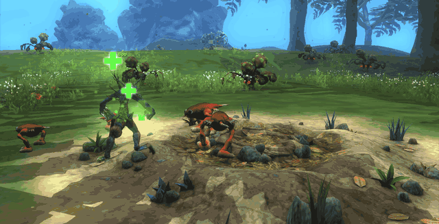
  <br><sub>Two players in the Creature stage, recorded in the current build: Alice (red, the host) and Bob (his own creature from <i>My Creations</i>).</sub>
</p>

## Quick start

1. **Download** `SporeCoopSetup.exe` from [Releases](https://github.com/WoodyWizard/SporeCoop/releases/latest) and run it
   (on Linux: inside the game's Wine prefix, e.g. Bottles *Run Executable...*).
2. **Install**: the setup finds Spore + Galactic Adventures (GOG or Steam), downloads the newest SporeCoop and checks it.
   Every player installs the same version.
3. **Play**: start Spore, galaxy menu → **Co-op**, type your name. One player picks **Host a game** → **Host**, the
   others **Join a game** and click the game under *Games on your network* (or type the host's address). The host's
   world loads for everybody.
   Over the internet: a virtual LAN such as Tailscale, or UDP port 47810 forwarded ([how](docs/INSTALL.md#7-playing-over-the-internet)).

More: [Install](#install) · [How to play](#how-to-play) · [Compatibility](#compatibility) · [FAQ](#faq)

## What's new

**0.7.12**, a feature update built from your suggestions:

- **A new co-op window** in steps: your name, *Host a game* or *Join a game*, a lobby with player colours.
- **Session settings:** the host turns co-op mechanics on or off (shared healing in Cell, friendly fire, bonuses...).
- **Find each other:** an arrow to every partner off screen, partners on the minimap, a colour for each player.
- **One report for the session**, and *Report a problem* in the pause menu. **Space:** terraforming and colony
  buildings now reach every player.

Every change: [CHANGELOG.md](CHANGELOG.md) · downloads and release notes: [Releases](https://github.com/WoodyWizard/SporeCoop/releases).

## Contents

- [Quick start](#quick-start) · [What's new](#whats-new) · [Features](#features) · [Session settings](#session-settings) · [Every stage together](#every-stage-together) · [Install](#install) ·
  [Compatibility](#compatibility) · [How to play](#how-to-play) · [FAQ](#faq) · [Status and roadmap](#status-and-roadmap) ·
  [Community](#community) · [Building from source](#building-from-source) · [Credits](#credits)

## Features

**SporeCoop** is a multiplayer mod for Spore. Two to four friends evolve **in one world**, from the
tide pool to the galaxy: everybody plays their own creature, the host's world is shared with the
guests, and every stage has mechanics that only work together - revive a knocked-out cell, hunt as
a pack, besiege a city from two sides, repair your partner's ship before it explodes.

- **Co-op from the main menu.** A *Co-op* item in Spore's own galaxy menu: host a game, find
  friends on your network or type an address, chat and get ready in the lobby. **F9** opens it in game.
- **Your session, your rules.** The host decides which co-op mechanics are on: see
  [Session settings](#session-settings).
- **Find each other.** Every player has a colour. A partner who is off screen gets an arrow at the edge of your
  screen with the name and the distance, and in Creature and Tribe partners show on the minimap.
- **One report for the session.** When something goes wrong, the host collects every player's report into one
  file (each player agrees first): [how to report](docs/REPORTING.md).
- **One world.** The host's save is sent to every guest and loaded automatically. The host
  simulates creatures, tribes, cities and ships; guests see the same world and act through the host.
- **Your own creations.** Everybody plays their own creature, cell and spaceship from
  *My Creations*, and the others see it.
- **Evolve together.** Entering an editor or the next stage starts a vote; it begins when everybody
  is ready, and the evolved world goes to everybody.
- **Native look.** Windows, fonts and slide-in notifications use Spore's own interface.
- **Safe for your saves.** A guest keeps the host's world in a separate slot; your own saves are
  never overwritten.

<table>
  <tr>
    <td width="50%">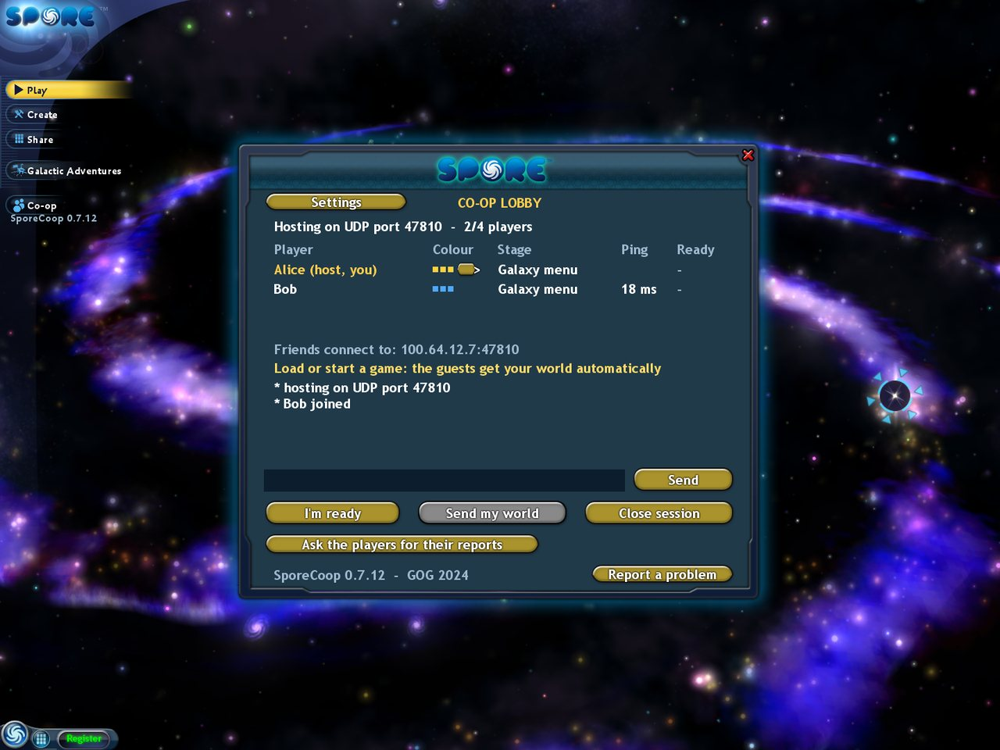</td>
    <td width="50%">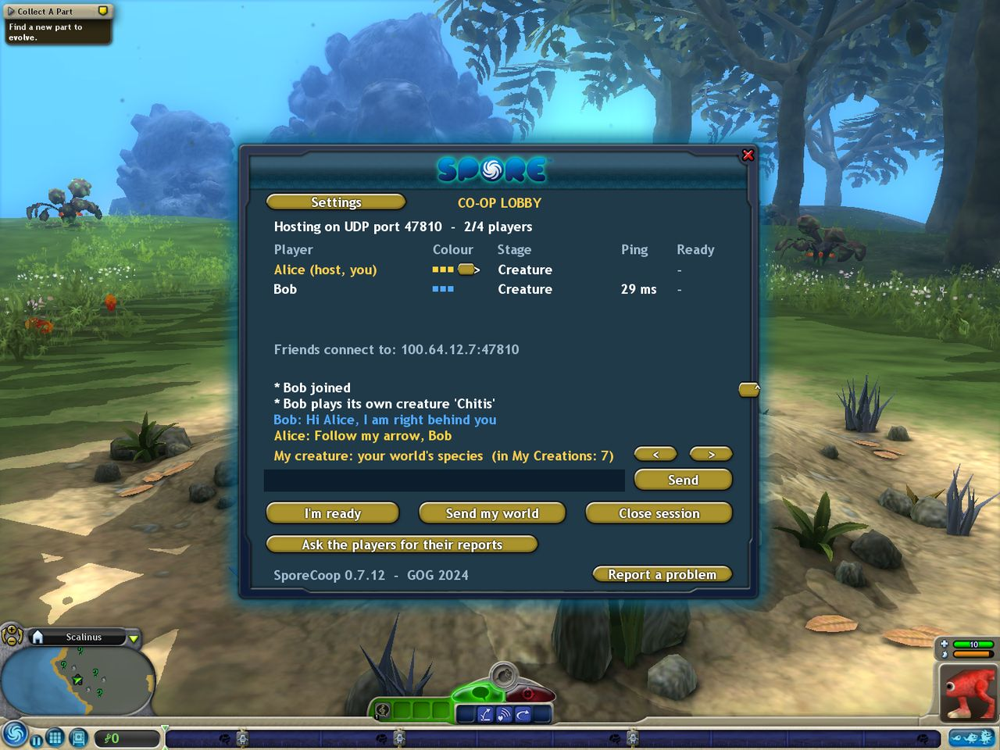</td>
  </tr>
  <tr>
    <td>The lobby in the galaxy menu: players with their colours, the address for your friends, <b>Settings</b>.</td>
    <td>In game, <b>F9</b>: players, chat in each player's colour, your own creature, the host's buttons.</td>
  </tr>
  <tr>
    <td>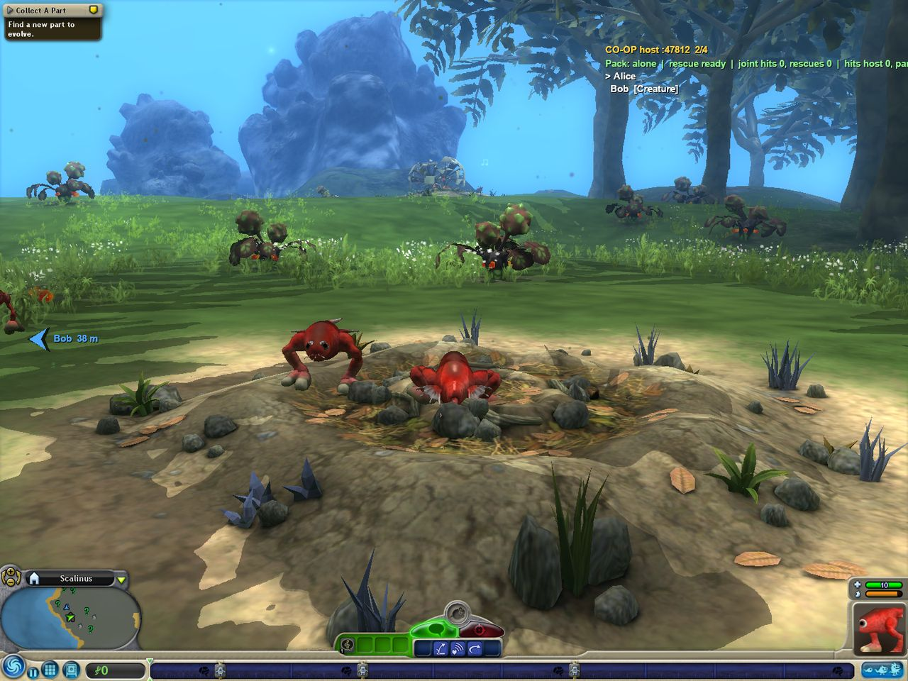</td>
    <td>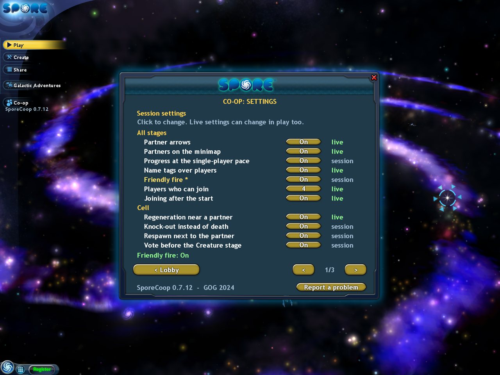</td>
  </tr>
  <tr>
    <td>Bob is off screen: an arrow in his colour at the edge, with his name and distance.
      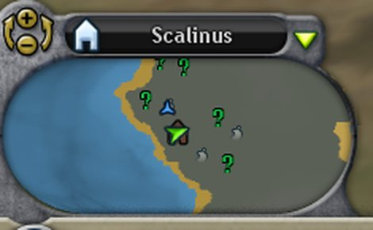</td>
    <td>The host's <b>Settings</b> page: <i>live</i> settings can change during play too.</td>
  </tr>
</table>

### Session settings

The host picks them in the lobby (**Settings**); every player gets them when joining, and they are kept with the
host's world for the next session. Guests see them but cannot change them. Most settings are fixed once the game
has started; the ones marked *live* can also be changed during play (F9). Every setting is on by default unless
said otherwise, so a new world plays as before.

- **Partner arrows**, **partners on the minimap** and **name tags** over players (all *live*).
- **Friendly fire**: players can hurt each other (off by default; the Creature stage only for now).
- **Cell:** regeneration near a partner (*live*), a knock-out instead of death next to a partner, the respawn next to
  the partner as a small cell.
- **Creature:** the pack bonuses (pack rescue, healing each other, the joint hunt bonus), and *everybody plays the
  host's creature*: one species for all, only the host evolves it (off by default: everybody plays their own).
- **Tribe** (pincer bonus, chief aura, the duet, the epic creature event), **Civilization** (roles, the joint siege
  bonus, the superweapon vote) and **Space** (disabled instead of destroyed, trade, contracts, shared diplomacy,
  allies, the finale together, rivals mode): each bonus on or off.
- How many players may join (2 to 4) and whether they may join after the start (*live*), progress (DNA, food) at
  the single-player pace, NPC animals treating partners like the host's creature, and a few more.

## Every stage together

| Stage | What you do together |
|---|---|
| 🦠 **Cell: Symbiosis** | One tide pool. A killing bite only knocks you out for 10 s: a partner who swims right next to you revives you, otherwise you respawn as a small cell next to them. |
| 🦎 **Creature: Pack** | Hunt the same animals for +25 % damage; when you are about to die near a partner, the pack saves you; partners heal each other. |
| 🔥 **Tribe: Chiefs** | The tribe's members are split between players, each with their own chief (+20 % aura). Attack a tribe from two sides for +50 % (a *pincer*), perform together to make friends faster, kill the epic creature together for 80 food. |
| 🏙️ **Civilization: Governors** | Every player governs their own cities and vehicles and picks a role: military, economic or religious. Two players besieging one city take it 50 % faster; a city under attack calls the others; superweapons fire only after a vote. |
| 🚀 **Space: A galaxy together** | Each of you rules your own territory in one galaxy. See your partners on the galaxy map and fly to them with a click, defend each other's colonies, trade spice and give tool charges, take co-op contracts (a pirate armada that needs two ships, joint surveys), share one diplomacy toward the NPC empires and reach the galactic core together. A destroyed ship next to a partner is only disabled for 20 s. Or play as **rivals**: own budgets, alliances, wars, ship against ship. |

<table>
  <tr>
    <td width="50%">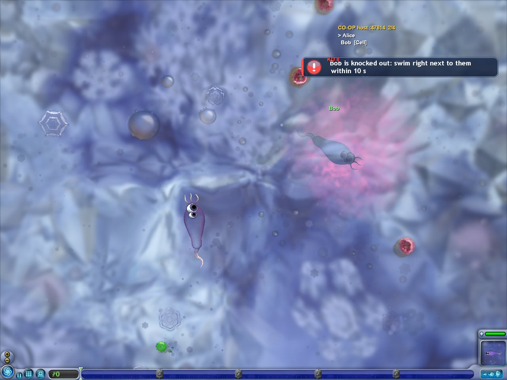</td>
    <td width="50%">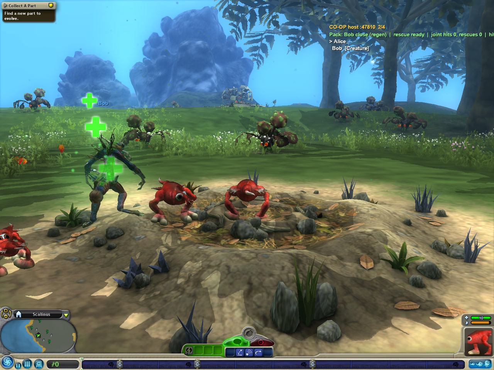</td>
  </tr>
  <tr>
    <td><b>Cell.</b> Bob is knocked out: Alice has 10 s to swim right next to him and revive him.</td>
    <td><b>Creature.</b> Bob plays his own creature from <i>My Creations</i> in Alice's world, one pack.</td>
  </tr>
  <tr>
    <td>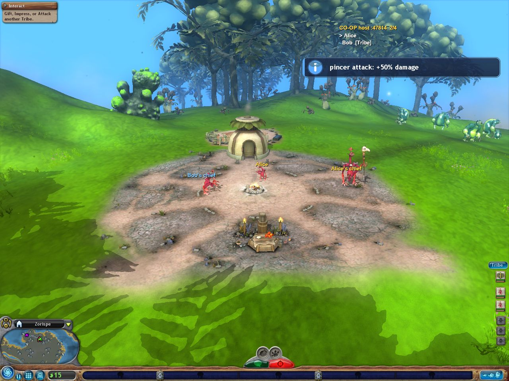</td>
    <td>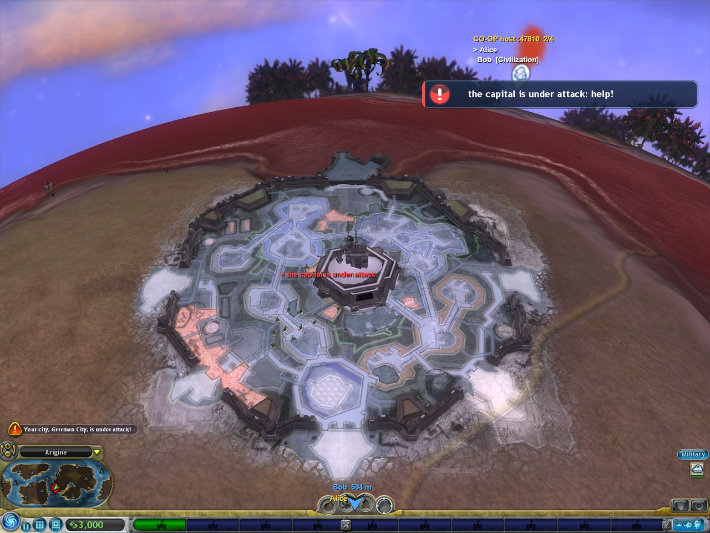</td>
  </tr>
  <tr>
    <td><b>Tribe.</b> Two chiefs, one village: attack from two sides for a <i>pincer</i> bonus.</td>
    <td><b>Civilization.</b> A city is under attack: every player gets the alarm and a beacon.</td>
  </tr>
  <tr>
    <td colspan="2" align="center">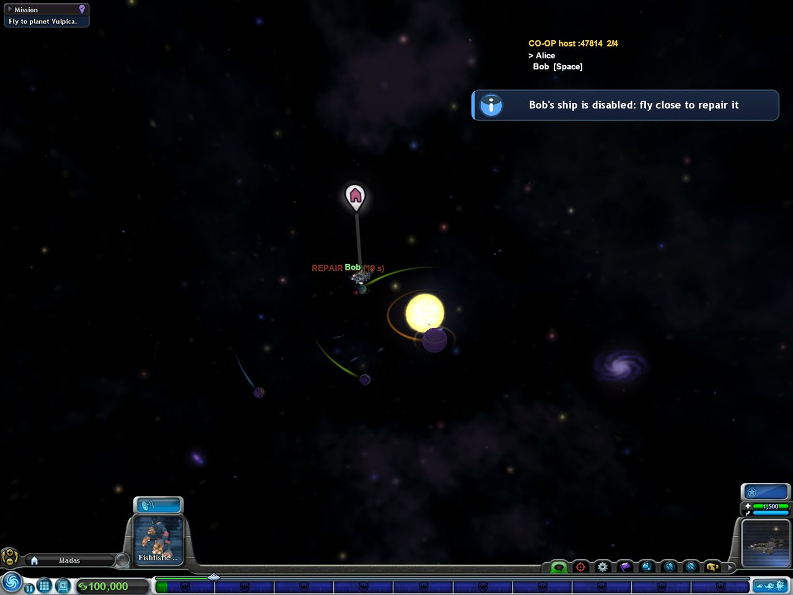<br>
    <b>Space.</b> Bob's ship is disabled: a <i>REPAIR</i> beacon and a 20 s countdown.</td>
  </tr>
</table>

## Install

You need **Spore with Galactic Adventures** from **GOG** or **Steam**, on Windows or on Linux with
Wine (Bottles, Lutris, Proton). Which versions are tested: [Compatibility](#compatibility). Every
player installs the same SporeCoop version.

1. Download **`SporeCoopSetup.exe`** from [Releases](https://github.com/WoodyWizard/SporeCoop/releases/latest)
   and run it (on Linux: inside the game's Wine prefix, e.g. Bottles *Run Executable...*).
2. It finds the game (GOG or Steam), shows which build you have, and **Install** downloads the
   newest release from GitHub and checks it. Steam: Galactic Adventures has its own folder,
   `steamapps\common\Spore 24720` (the one with `SporebinEP1`; base Spore's `steamapps\common\Spore`
   has none). If the setup does not find it, choose that folder. No `Spore 24720` folder means the
   *Spore Galactic Adventures* DLC is not installed: SporeCoop needs it.
   The setup says "GitHub not reachable"? See [Troubleshooting](docs/INSTALL.md#9-troubleshooting)
   (or use the release zip's `install.bat`).
3. Start Spore: the galaxy menu now has a **Co-op** item.

**Updates** come from this repository's releases: SporeCoop checks for a new version when the game
starts, and the *Co-op* window offers an **Update** button (`[update] check=0` in `mods\coop.ini`
turns the check off). The setup updates and uninstalls too. Prefer files? The release zip has
`install.bat` / `uninstall.bat`.

The full guide (checking your game build, Linux, installing by hand, the internet, updating,
uninstalling, troubleshooting) is in **[docs/INSTALL.md](docs/INSTALL.md)**.

## Compatibility

You need **Spore with Galactic Adventures**. SporeCoop runs its game, `SporebinEP1\SporeApp.exe`.

| Game version | Windows | Linux (Wine / Proton) |
|---|:---:|:---:|
| **GOG**, the current download (2024 update) | ✅ | ✅ |
| **Steam**, Spore + Galactic Adventures | ✅ | ✅ |

GOG and Steam players can play together; every player needs the same SporeCoop 0.7 version.
The **EA app / Origin** and **disc** versions are not supported (co-op stays off), and the older
**GOG 2016** build is no longer supported since 0.7.8: update the game through GOG.
Which build you have, file sizes and hashes, the Steam overlay, mixing versions and every test:
[INSTALL.md, compatibility details](docs/INSTALL.md#compatibility-details).

## How to play

**The first time**

1. Galaxy menu → **Co-op**. The window asks for your name: the one the other players see. Type it → **Continue**
   (you can change it later with *Change name*).
2. Then choose **Host a game** or **Join a game**.

**Host**

1. **Host a game** → **Host** (the port is 47810; change it only if you forwarded another one). The window shows
   the addresses your friends can use (*Friends connect to: ...*).
2. The lobby opens. **Settings** (top left) shows the [session settings](#session-settings): change them now,
   before the game starts; the ones marked *live* can also be changed later in game (F9).
3. Load a save or start a new game. You can play alone right away: friends can join any time and get your world by
   themselves.

**Guest**

1. **Join a game**, then either click the host's game under *Games on your network*, or type the host's address
   (e.g. `100.64.12.7` on Tailscale) or host name (e.g. `alice-pc`) in the address field → **Join**. Without a port
   the default port 47810 is used; another one goes after a colon (`100.64.12.7:47811`).
2. The lobby opens; the host's world arrives and loads by itself, and you appear next to the host with your own
   creature.

**The lobby**

- Every player has a colour, shown in the lobby, the chat, the name tags, the arrows and the minimap. Click the
  small **>** next to your own colour to try the next one (a colour another player has is skipped).
- *I'm ready*, the chat, and the host's address (*Host address: ...*) for friends who want to join too.
- **Close session** (host) ends the session for everybody; a guest's **Leave** goes back to *Join a game*.

**In game**

| Key / command | What it does |
|---|---|
| **F9** | the co-op window: players, colours, stage, ping, readiness, chat, *Settings*, *Send my world*, *Leave* / *Close session* |
| *Settings* | the F9 window: the session settings; the host changes the *live* ones during play, guests see them |
| *Report a problem* | the F9 window, and also the game's pause menu (Esc): makes a report file ([how to report](docs/REPORTING.md)); the host's report also asks every guest for theirs |
| *Ask the players for their reports* | the host's F9 window: collects every player's report into one file at any time; each guest clicks *Send* or *Don't send* |
| *My creature: … < >* | the F9 window: pick your own creature or cell from *My Creations*; without one of that kind you play the host's species (make one in an editor to get a choice) |
| *Send my world* | the host sends the world again to everybody (greyed out until a game is loaded and somebody has joined) |
| *I'm ready* | agree to evolve (editor, next stage) |
| `Ctrl+Shift+C` → `coop status` | session details in the cheat console |
| `coop say <text>` | chat |
| `coop ping` | show everybody the place under your mouse (Tribe, Civilization) |
| `coop give` | give your selected tribe members, vehicles or the opened city to a partner |
| `coop role 1`…`3` | Civilization role: military, economic, religious |

**Example: two friends over the internet**

```
Alice (GOG) and Bob (Steam) install Tailscale and the same SporeCoop version.
Alice: Co-op → "Alice" → Host a game → Host → loads her Tribe save.
       The window says: Friends connect to: 100.64.12.7:47810
Bob:   Co-op → "Bob" → Join a game → 100.64.12.7 → Join.
       Alice's tribe loads; Bob gets his share of the members and his own chief.
Both:  F9 → I'm ready when the tribe is ready for Civilization.
```

## FAQ

**Which game versions does it work with?** The current GOG and Steam versions of Spore + Galactic
Adventures, on Windows and Linux: see [Compatibility](#compatibility). The Steam version is the GOG
2024 game under Steam's DRM: SporeCoop waits until the game has unpacked itself and checks the code,
so Steam and GOG players can play together. The EA app and disc versions are not supported yet
(their `SporeApp.exe` is a different file: the game runs, co-op stays off). Every test, build by
build: [INSTALL.md, section 2](docs/INSTALL.md#where-sporecoop-has-been-tested).

**Do all players need the game?** Yes, every player needs their own copy of Spore + Galactic
Adventures (GOG or Steam) and the same SporeCoop version.

**What happens to my saves?** Nothing: the host saves before sending its world; guests keep the
host's world in a separate save slot, and a guest's own save of the same planet is moved to
`Games-sporecoop-backup` first.

**Can we play in different stages?** The host decides the stage; a guest who is somewhere else is
brought to the host's world.

**Does it change the game files?** It replaces `steam_api.dll` with a small loader (the original
is kept as `steam_api_orig.dll` and still used) and adds `sporekit.dll`, a `mods` folder and
`Data\SporeCoop.package`. `uninstall.bat` restores everything.

**Is it safe?** The whole source is here, and the release files are built from it by
[GitHub Actions](https://github.com/WoodyWizard/SporeCoop/actions). The mod listens on UDP 47810 only
while you host; its debug console accepts connections from your own PC only (127.0.0.1). A world
or creature received from another player is checked before it touches the disk: plain file names
inside the save slot only, limited sizes. Updates are downloaded only from this repository's GitHub releases over HTTPS, checked
against the release's SHA-256 sums, and may only replace SporeCoop's own files.

## Status and roadmap

Version 0.7.12 (the newest release is on the [Releases](https://github.com/WoodyWizard/SporeCoop/releases/latest) page): co-op in every stage for up to 4 players, and a Space stage built for playing
together (the F9 window's **Space** page: partners on the map, allied colonies, trade, contracts,
shared diplomacy, the galactic core together, rivals mode). Tested automatically on real game
instances: 770+ scenario tests with real clicks, bots that play every stage through real input for
hours, 4-player sessions with rejoins, a chaos bot and simulated bad networks
([stability report](docs/stability-report.md)). 690+ reported bugs are fixed so far, each with its
own ticket and a test ([docs/tickets](docs/tickets/README.md)).
Known issues: [docs/known-issues.md](docs/known-issues.md). Found a problem? Type `/bug <what you
see>` in the co-op chat when it happens (it marks that moment in every player's log), then see
[how to report it](docs/REPORTING.md).

Next:

- [ ] easier internet play (no VPN or port forwarding)
- [ ] tests with the EA app build, and of the Steam build with Steam online (overlay)
- [ ] four-player tests of the 0.7 Space features, co-op adventures
- [ ] **Rivals mode**: every player with a base, a species, a tribe, a nation and an empire of its
  own in the same world, a race through every stage with war, peace and alliances
  ([design](docs/11-rivals.md))

## Community


Join the **[SporeCoop Discord](https://discord.gg/7Yre7u4b8x)**: find players to evolve with, ask for help with the setup,
share your worlds and creatures, report problems and suggest ideas. Bug reports with files are
easiest to follow up as a [GitHub issue](https://github.com/WoodyWizard/SporeCoop/issues/new/choose)
([how to report](docs/REPORTING.md)).

## Building from source

SporeCoop is built on Linux with [llvm-mingw](https://github.com/mstorsjo/llvm-mingw) (32-bit
Windows targets) and tested under Wine/Bottles.

```bash
git clone https://github.com/WoodyWizard/SporeCoop.git   # inside the SPORE game folder
cd SporeCoop
make LLVM_MINGW=/path/to/llvm-mingw   # steam_api.dll (loader), sporekit.dll, coop.dll, SporeCoop.package
make test                             # unit tests (netcode, save format) + symbol check
tools/package.sh                      # out/dist/SporeCoop-<version>.zip
```

| Part | What it is | Where |
|---|---|---|
| loader | `steam_api.dll` proxy: the game loads it and it starts SporeKit | [`loader/`](loader/) |
| SporeKit | runtime inside the game: symbols, hooks, console, input, hot reload, crash and hang logs | [`sporekit/`](sporekit/), [`sdk/`](sdk/include/) |
| coop | the mod: sessions, world sharing, one module per stage, the co-op window | [`mods/coop/`](mods/coop/) |
| symbols | addresses of game functions for this build (2 400+ ported, 240 verified by hand) | [`data/symbols/`](data/symbols/) |
| tests | two-instance scenario tests, chaos bot, bad-network proxy, the parallel test lab | [`tools/tests/`](tools/tests/), [`tools/lab.py`](tools/lab.py) |

Documentation: [architecture](docs/01-architecture.md), [netcode](docs/04-netcode.md),
[reverse engineering](docs/05-re-notes.md) and [per-stage notes](docs/re/),
[testing](docs/06-testing.md), [development pipeline](docs/10-dev-pipeline.md):
all in [docs/](docs/README.md). Contributions are welcome: open an issue first for bigger changes.

## Credits

- Built by [WoodyWizard](https://github.com/WoodyWizard).
- Function names and addresses were ported from [Spore ModAPI](https://github.com/Spore-Community/Spore-ModAPI)
  by the Spore modding community; hooks by [MinHook](https://github.com/TsudaKageyu/minhook).
  Details and licenses: [THIRD_PARTY_NOTICES.md](THIRD_PARTY_NOTICES.md).
- Spore is a trademark of Electronic Arts Inc. SporeCoop is an unofficial fan mod, not affiliated
  with or endorsed by Electronic Arts or Maxis. It contains no game files.

Licensed under the [MIT license](LICENSE).

<!-- support:bottom:start -->
## ☕ Support the author

If this project is useful to you, you can support the author - it really helps to keep working on it:
**https://buymeacoffee.com/chamomilewoods**

<a href="https://buymeacoffee.com/chamomilewoods"></a>
<!-- support:bottom:end -->
